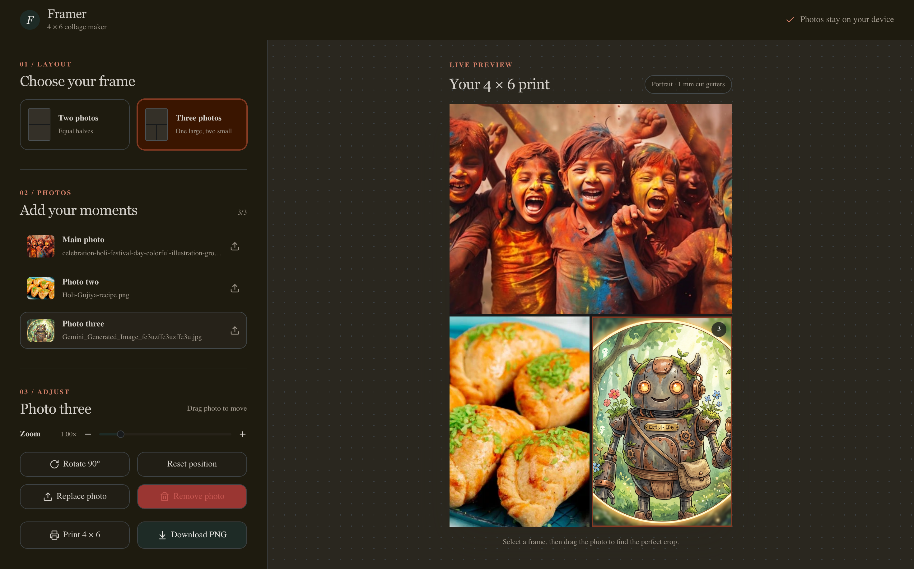

# Framer

Framer is a small, local-first photo collage editor built for one practical job: turning two or three photos into a printable 4 × 6 collage without sending the photos anywhere.



## Why I built this

Creating photo collages for printing is part of an annual task for me. I do not like uploading personal pictures to random online tools, and the desktop alternatives I tried were either clunky when repeating the same workflow or far more advanced than necessary for a simple collage. I built Framer specifically to make that recurring task quick and predictable: choose a layout, add the photos, adjust the crop, and print or download the finished 4 × 6 image.

Framer was coded with AI. I defined the problem, requirements, and workflow, then worked iteratively with OpenAI Codex to build, test, and refine the application.

## What it does

- Creates a two-photo collage with equal halves
- Creates a three-photo collage with one large landscape slot and two portrait slots
- Accepts JPEG, PNG, HEIC, and HEIF images
- Lets you drag, zoom, rotate, replace, and remove each photo
- Adds 1 mm white gutters so printed photos can be cut apart cleanly
- Prints directly at 4 × 6 inches
- Exports a 1200 × 1800 PNG suitable for 300 DPI printing
- Processes every photo locally in the browser—nothing is uploaded

## Run locally

### Requirements

- Node.js 22.13 or newer
- pnpm 9

Install the dependencies and start the development server:

```bash
pnpm install
pnpm dev
```

Then open [http://localhost:3000](http://localhost:3000).

## Production build

```bash
pnpm build
```

## Privacy

All image processing, including HEIC and HEIF conversion, happens locally in the browser. Large HEIC files may take a moment to convert, but the source photos never leave your device.
